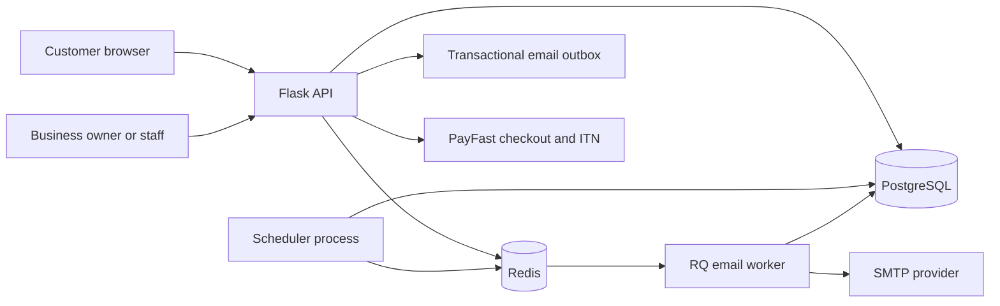

# Booking Platform

[](https://github.com/Legionaka/booking_plat/actions/workflows/ci.yml)

A multi-tenant booking platform for barbers, clinics, tutors, and other appointment-based businesses. It provides public availability and booking flows, business administration, secure customer accounts, PayFast deposits, and reliable email reminders while keeping each business's data isolated.

## Architecture



## Features

- Tenant-scoped business, service, staff, working hours, and time-off management.
- Public availability with timezone-aware slots and booking creation, cancellation, and rescheduling.
- PostgreSQL-backed booking lifecycle, PayFast deposit handling, and idempotent payment notifications.
- Customer accounts, server-side sessions, email verification, password reset, and role checks.
- Transactional email outbox, RQ worker, scheduler, and booking reminders.
- Owner calendars, analytics, customer history, audit logs, and deterministic demo data.
- Docker Compose for local PostgreSQL and Redis; Render blueprint for hosted deployment.

## Design decisions

- **Database exclusion constraint:** PostgreSQL prevents overlapping active bookings for the same staff member, including service buffers. Application checks improve error messages, while the database remains the concurrency authority.
- **UTC storage:** Instants are stored in UTC. Business-local dates and working-hour windows are converted using each business's IANA timezone.
- **Integer cents:** Prices, deposits, and payments use integer cents to avoid floating-point currency errors.
- **Transactional outbox:** Booking and payment transactions write notification intent into PostgreSQL. Workers deliver email after commit and retry failures.
- **Idempotent webhooks:** PayFast ITN processing locks payment records and ignores repeated completion events.
- **Tenant scoping:** Queries for business-owned data include `business_id`; unauthorized cross-business reads return not found.

## Run locally

Requirements: Docker Desktop with Compose and Python 3.12+ for local CLI commands.

```sh
Copy-Item .env.example .env
docker compose up --build db redis web worker scheduler
```

The API is available at `http://localhost:5000`. For an optional demo business, run:

```sh
docker compose exec web flask --app app:create_app seed-demo
```

Local email uses the console backend by default and prints complete messages, including verification and reset links, to the web container output. To catch SMTP messages in Mailpit instead, replace the existing email/SMTP settings in `.env` with the optional Mailpit settings in `.env.example` (do not append duplicate keys), then start the dev profile:

```sh
docker compose --profile dev up
```

Open the inbox at [http://127.0.0.1:8025](http://127.0.0.1:8025). Open a verification or password-reset message and follow the link in its plain-text body. Mailpit's SMTP and web UI ports bind to loopback only. The default console backend prints message bodies only when `APP_ENV=development`; other environments never print email bodies or tokens.

The default demo owner login (`owner@fade-lab.demo` / `DemoOnly-ChangeMe-2026!`) is for local demos only. Change the demo credentials before sharing a non-production environment. Overnight shifts must be entered as two working-hour ranges because each range requires `end_time` later than `start_time`.

See [docs/environment.md](docs/environment.md) for configuration and [docs/operations.md](docs/operations.md) for migrations, backups, restore, and deployment operations.

## Run tests

Start the PostgreSQL and Redis services, then run the same full check sequence used by CI:

```sh
docker compose up -d db redis
python scripts/check.py
```

The script installs the hashed development lock, prepares dedicated test databases, runs Ruff, the strict frontend policy scan, the full pytest suite, and builds the production Docker image. Set `TEST_DATABASE_URL`, `MIGRATION_DATABASE_URL`, and `TEST_REDIS_URL` if you use dedicated test resources instead of the local Compose defaults.

Dependency ranges live in `requirements.in` and `requirements-dev.in`; the hashed locks are compiled with pip-tools. See [docs/operations.md](docs/operations.md#dependency-updates-and-local-verification) for the update procedure. Dependabot checks pip, GitHub Actions, and Docker weekly.

## Roadmap

- Frontend pages implemented from the approved Figma frames.
- Owner calendar and analytics views.
- Production SMTP account configuration and monitoring dashboards.
- Future payment operations such as automated refunds, if approved.

## Live demo and screenshots

- **Live demo:** `[Deployment URL to be added]`
- The demo runs in PayFast sandbox mode; no real payments are processed.
- **Screenshots:** `[ product screenshots here]`

