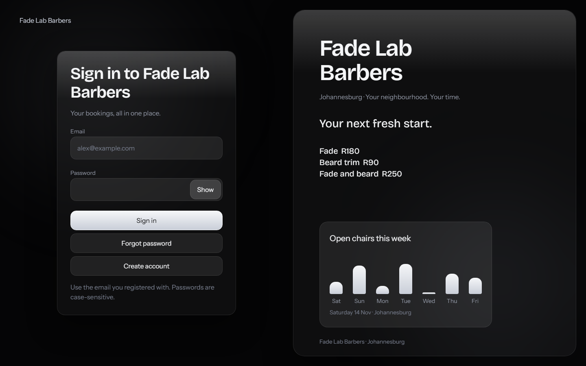
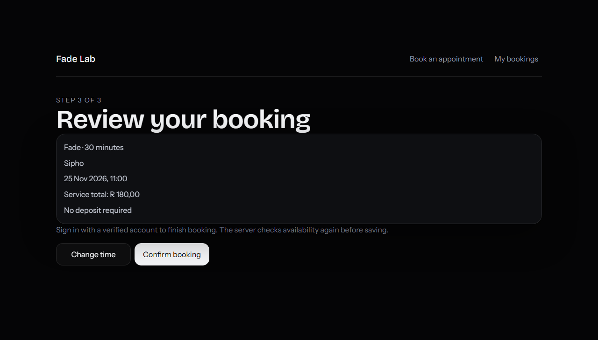
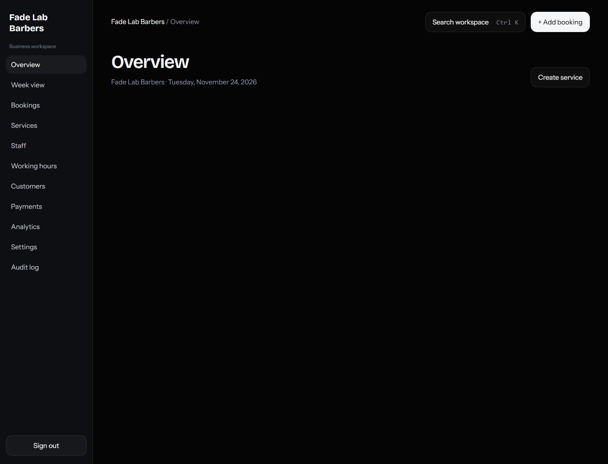
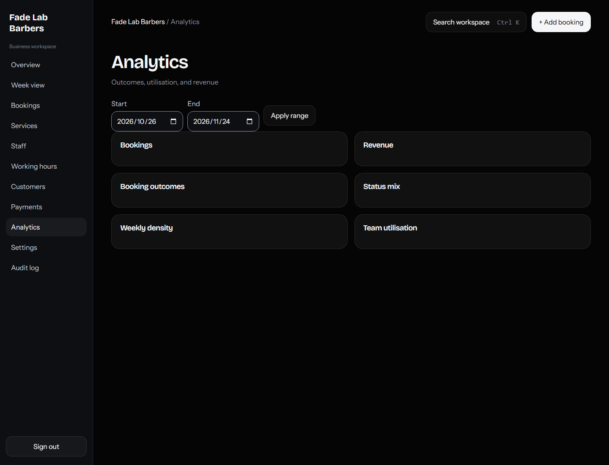
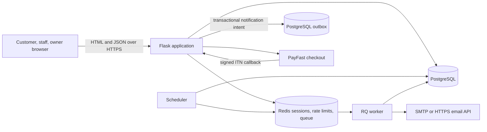

# Booking Platform

[](https://github.com/Legionaka/booking_plat/actions/workflows/ci.yml)

A multi-tenant booking platform for appointment-based small businesses. Customers can find availability, book, pay a deposit through PayFast, and manage appointments; owners and staff manage schedules and services through a tenant-scoped workspace. Flask, PostgreSQL constraints, and an idempotent outbox keep booking and notification work reliable.

**Live demo:** [booking-plat.onrender.com](https://booking-plat.onrender.com). The demo is configured for sandbox payments only; no real payment is taken. Demo credentials are provided by the hosted demo environment and are not repeated in this repository. The local seeded demo login is `owner@fade-lab.demo` / `DemoOnly-ChangeMe-2026!`; use only for local development.

## Screenshots

Playwright generates the product captures below into `docs/assets/screenshots/` during the database-backed browser suite. The login capture is also maintained by the responsive auth screenshot run.

| Landing | Authentication | Customer booking | Owner dashboard | Analytics |
| --- | --- | --- | --- | --- |
|  |  |  |  |  |

The public `/` landing page is a portfolio and product introduction, with a keyboard-operable slot picker, live demo paths, engineering detail, and no contact email. It is implemented in code rather than a separate Figma landing frame.

## Features

**Customers:** public business and service pages, timezone-aware availability, booking, deposit checkout handoff, payment status polling, booking history, cancellation and rescheduling.

**Owners:** onboarding, business settings, services and staff management, working hours/time off, day and week calendars, booking status actions, customers, payments, analytics, QR booking link, and audit log.

**Staff:** scoped calendar and booking actions for assigned work, with owner-only settings hidden and enforced by the API.

**Platform:** PostgreSQL overlap constraint, tenant-scoped APIs, server-side sessions and CSRF, PayFast ITN verification, SMTP/HTTP email backends, transactional outbox, RQ worker and scheduler, Docker Compose, and Render blueprint.

## Technology

| Area | Implementation |
| --- | --- |
| Web | Python 3.12+, Flask blueprints, Jinja templates |
| Data | PostgreSQL, SQLAlchemy, Alembic, Pydantic |
| Jobs | Redis, RQ worker and scheduler, transactional notification outbox |
| Payments | PayFast sandbox/live configuration with signed ITN handling |
| Email | Console for local development, SMTP/Mailpit, or HTTPS APIs (Brevo, Resend, Mailgun) |
| UI | Vanilla HTML/CSS/JS, self-hosted fonts, hand-written accessible SVG charts |
| Delivery | Docker, Docker Compose, GitHub Actions, Render |

## Architecture



## Design decisions

- **Overlap prevention:** PostgreSQL's partial GiST exclusion constraint rejects intersecting active staff booking ranges, including service buffers. The application maps that conflict to 409.
- **Time and money:** persist timestamps as UTC-aware instants; store amounts in integer cents and snapshot the booking price.
- **Outbox and idempotency:** booking/payment state and notification intent are committed together. Provider references and notification uniqueness make retries safe.
- **Tenant scope:** business-owned reads and writes include the business identifier, and cross-tenant access is tested.
- **Security and visual policy:** strict CSP disallows inline execution; UI uses flat monochrome tokens with no gradients, masks, or external assets.

```sql
EXCLUDE USING gist (
  staff_id WITH =,
  tstzrange(start_at, blocked_until, '[)') WITH &&
) WHERE (status IN ('pending', 'confirmed'));
```

## Run locally in five commands

Requires Docker Compose and Python 3.12+.

```powershell
Copy-Item .env.example .env
# In .env, set EMAIL_BACKEND=smtp and SMTP_HOST=mailpit (replace existing values).
docker compose --profile dev up --build -d
python -m pip install --require-hashes -r requirements-dev.txt
python -m flask --app app:create_app db upgrade
python -m flask --app app:create_app seed-demo
```

Open `http://localhost:5000`. Mailpit's inbox is at `http://127.0.0.1:8025`. If you leave the default console backend, development verification and reset links are printed in the web container log instead. Configuration details: [environment variables](docs/environment.md) and [operations](docs/operations.md).

## Tests and quality checks

Start Postgres and Redis with `docker compose up -d db redis`, then run:

```sh
python scripts/check.py --e2e
```

This installs locked development requirements, prepares dedicated test databases, runs Ruff, frontend policy, pytest with coverage, browser E2E/accessibility tests, render configuration contracts, and a Docker build. Run individual layers as documented in [docs/testing.md](docs/testing.md). Latest local results are recorded there after the full check; unavailable services are reported as blockers rather than inferred passes.

Verified on 2026-11-23: **273 backend tests passed, 1 platform-specific skip; 108 Chromium tests passed; 88.77% overall coverage and 89.85% service coverage; zero serious/critical axe findings.** Ruff, frontend policy, and the Docker image build passed. See [test details](docs/testing.md).

## Deploy to Render

The checked-in `render.yaml` provisions PostgreSQL, Redis, web, worker, and scheduler. Configure the production environment group, HTTPS base URLs, PayFast credentials, and `EMAIL_BACKEND=http_api` with a verified sender and provider API key. Render Free blocks outbound SMTP, so use the HTTPS email API. Review quotas, database retention, backups, and paid service limits before a public launch. See [operations.md](docs/operations.md).

## Project structure

```text
app/
  blueprints/
  models/
  schemas/
  services/
  jobs/
  templates/
  static/
docs/
  assets/screenshots/
  design/
  decisions/
migrations/
scripts/
tests/
  contract/
  e2e/
  integration/
  unit/
.github/
  workflows/
```

## Roadmap

Deferred work includes walk-in bookings (requires a product decision on customer identity), waitlist, staff invitations, TOTP, session management UI, multi-business switcher, platform-admin tools, and automated refunds. See [planning.md](docs/planning.md) and [Figma frame deferrals](docs/design/figma.md).

## License

MIT; see [LICENSE](LICENSE).

## Author

**Legion Cunningham** · [Portfolio](https://portfolio-v3-ochre-rho.vercel.app/)
