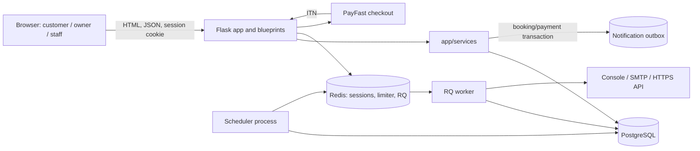
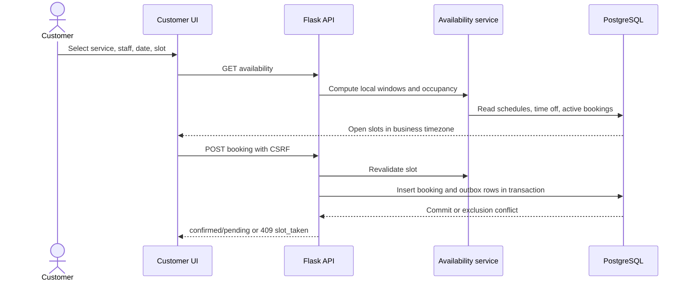
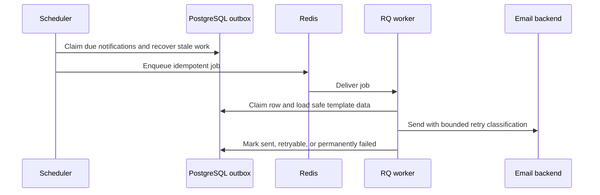
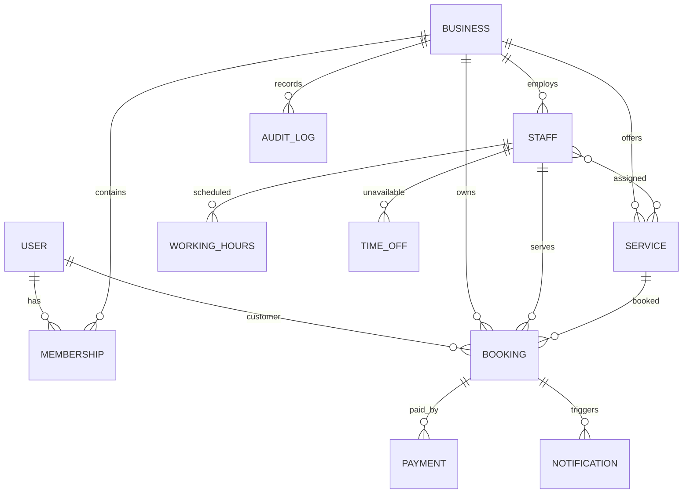

# Architecture

## Components



## Request flow

The Flask factory loads configuration, extensions, blueprints, CSP/security headers, and error handling. Blueprints parse and validate inputs, apply authentication and role checks, call services, and serialize responses. Services own transaction boundaries and tenant scoping. SQLAlchemy writes to PostgreSQL; Redis backs sessions, rate limits, and RQ. HTML pages are Jinja templates with external assets; browser requests use the JSON API.

## Booking sequence



## Payment sequence

```mermaid
sequenceDiagram
  actor Customer
  participant API as Flask API
  participant DB as PostgreSQL
  participant PF as PayFast
  Customer->>API: Request checkout for owned pending booking
  API->>DB: Create/reuse payment and signed fields
  API-->>Customer: Route-specific CSP checkout handoff
  Customer->>PF: Submit hosted payment form
  PF->>API: Form-encoded ITN callback
  API->>PF: Validate callback with provider
  API->>DB: Verify signature, amount, merchant, reference; idempotent update
  PF-->>Customer: Browser return
  Customer->>API: Poll booking status
  Note over API,DB: Browser return never confirms payment
```

## Job flow



## Data model



Alembic migrations are authoritative; `docs/schema.sql` is a reference. The booking exclusion constraint covers `staff_id` and `[start_at, blocked_until)` for pending and confirmed rows.
